# MOTORA 🚗

### Discover Your Next Ride

MOTORA is a Flutter-based car marketplace application designed to connect car buyers with dealerships. Users can explore available vehicles, view detailed specifications, save their favorite cars, and communicate directly with dealerships.

The project aims to provide a simple and modern experience for discovering cars and connecting with automotive dealerships.

---

## ✨ Features

### For Customers
- Browse available cars.
- Search for cars by brand, model, and other details.
- View detailed car information and images.
- Add cars to favorites.
- Contact dealerships directly.
- Chat with dealerships through inquiries.
- Access notifications.
- Browse the application as a guest.

### For Dealerships
- Create a dealership account.
- Manage dealership information.
- Publish and manage car listings.
- Add and update vehicle details.
- Upload car images.
- Communicate with potential customers.

---

## 🛠️ Tech Stack

| Technology | Purpose |
|---|---|
| Flutter | Cross-platform application development |
| Dart | Programming language |
| Supabase | Backend and database services |
| PostgreSQL | Database |
| Supabase Auth | User authentication |
| Supabase Storage | Image storage |
| Supabase Realtime | Real-time communication |
| Git & GitHub | Version control |

---

## 📱 App Screenshots

<p align="center">
  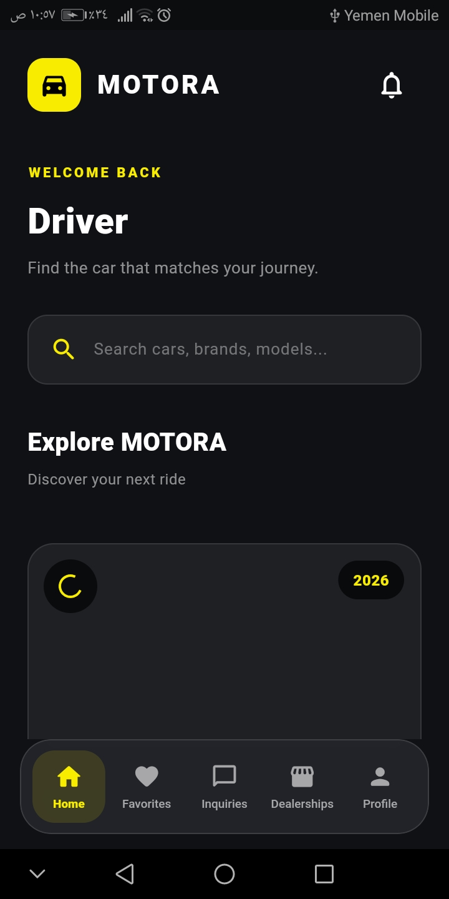
  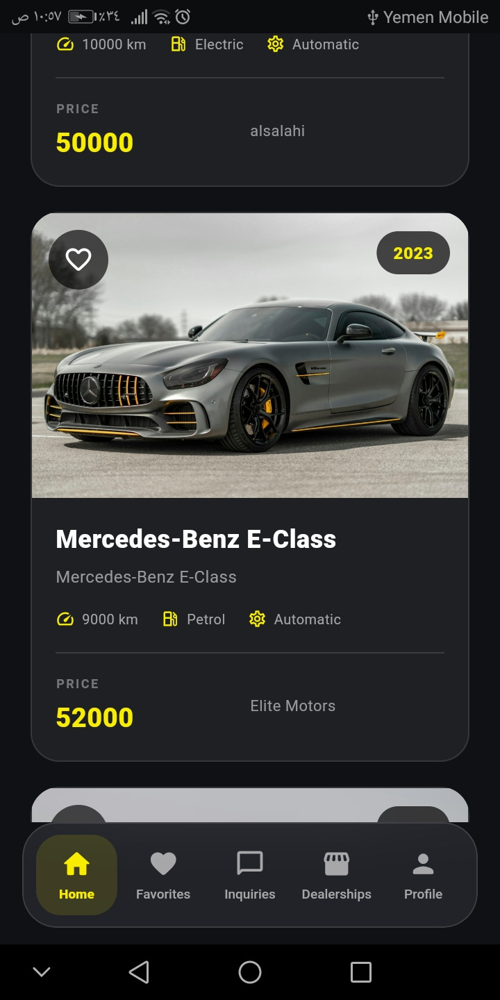
  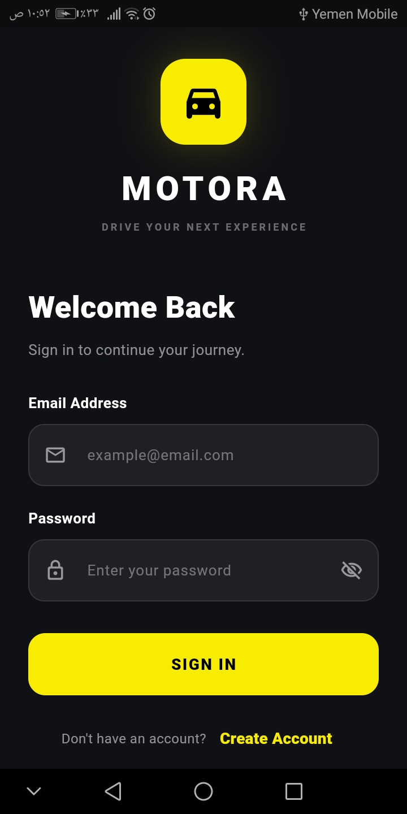
  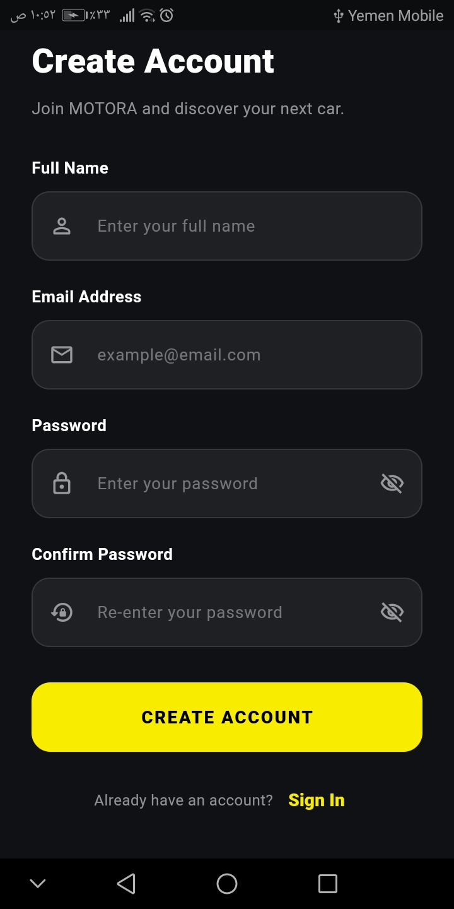
  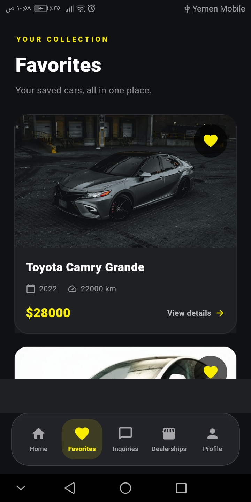
  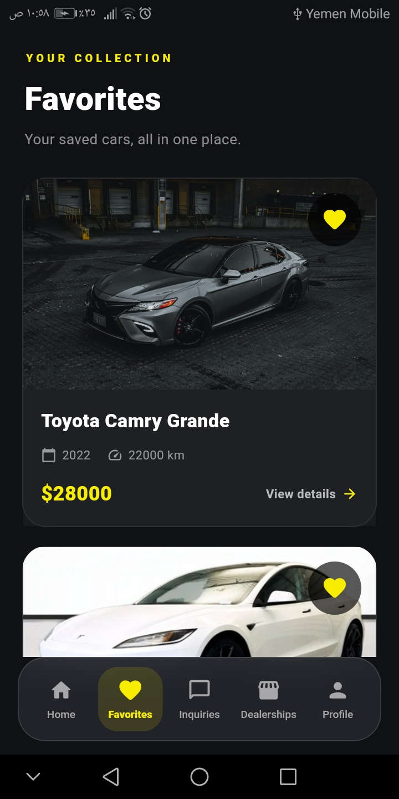
  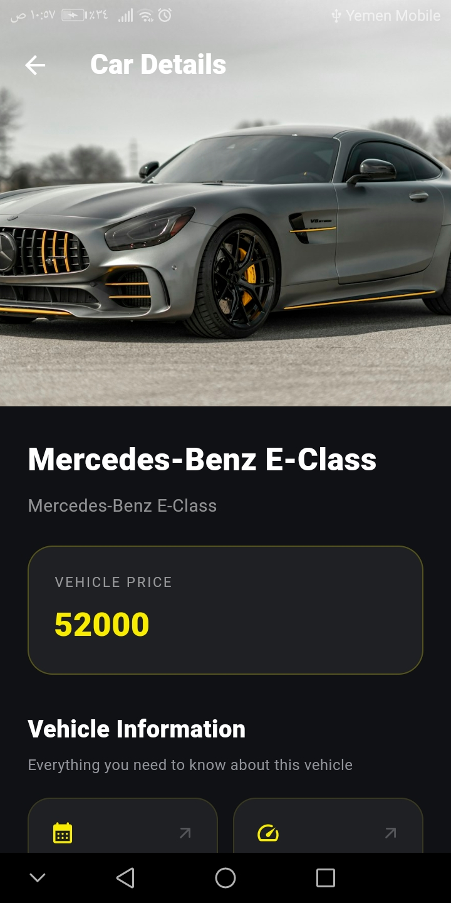
  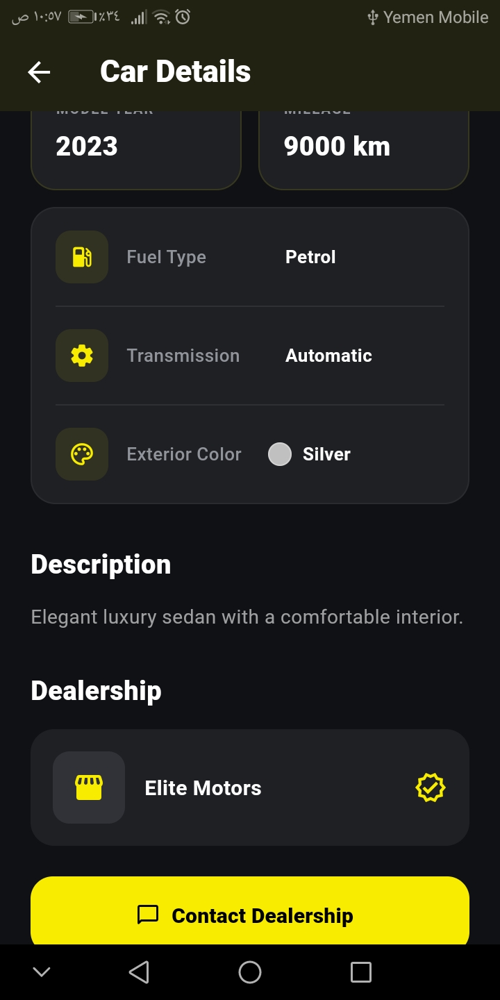
  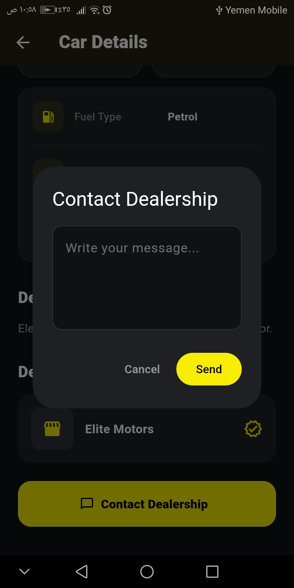
</p>

<p align="center">
  
  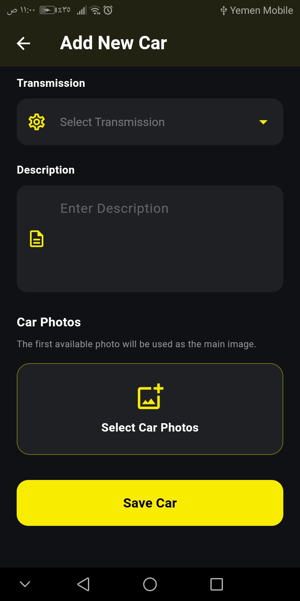
  
  
  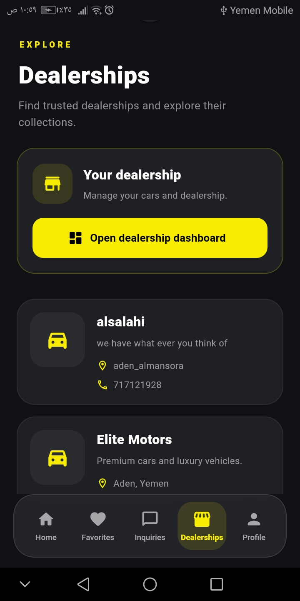
  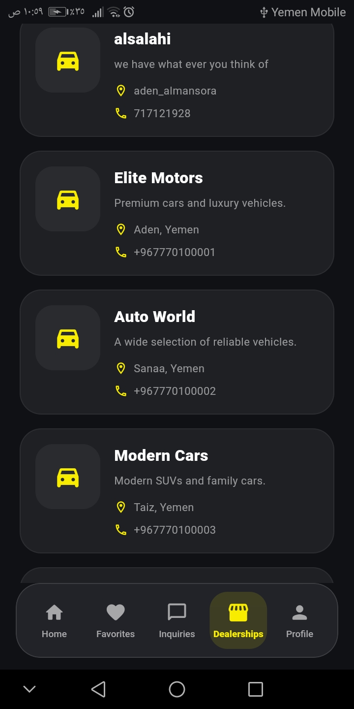
  
  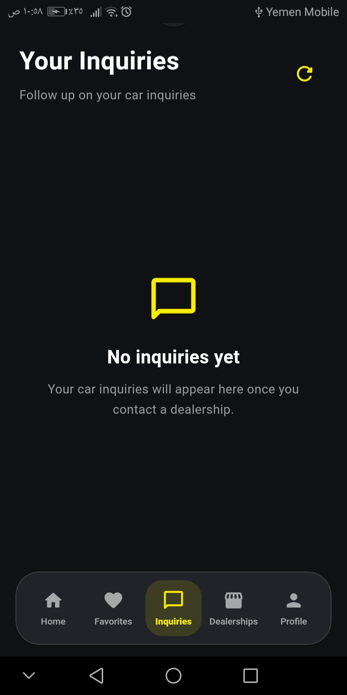
  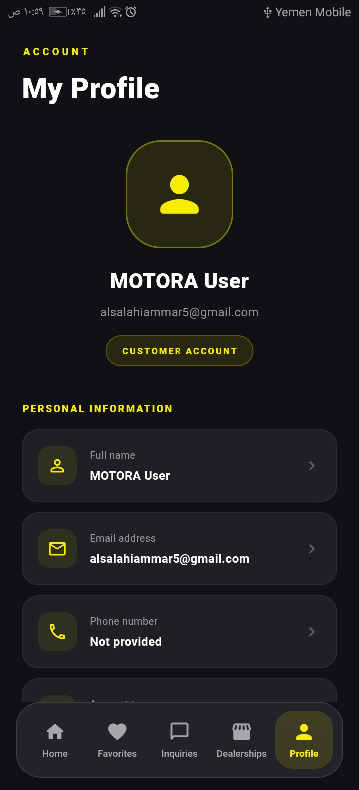
  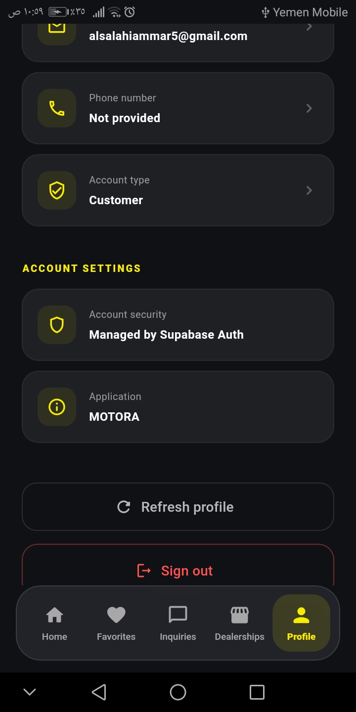
</p>
## 🏗️ Project Structure

The project follows a feature-based architecture to keep the code organized and maintainable.

```text
lib/
├── features/
│   ├── auth/
│   ├── home/
│   ├── favorites/
│   ├── inquiries/
│   ├── dealerships/
│   ├── notifications/
│   └── profile/
│
├── main.dart
└── ...
```

Each feature contains its own presentation and data-related components where applicable.

---

## ⚙️ Getting Started

### Prerequisites

Make sure you have installed:

- Flutter SDK
- Dart SDK
- Git
- A code editor such as VS Code
- A Supabase project

### 1. Clone the Repository

```bash
git clone https://github.com/ammaralsalahi/motora.git
```

### 2. Navigate to the Project

```bash
cd motora
```

### 3. Install Dependencies

```bash
flutter pub get
```

### 4. Configure Supabase

Create a Supabase project and configure the application with your Supabase project URL and publishable key.

Make sure the required database tables, authentication settings, storage buckets, and Row Level Security policies are configured.

**Important:** Never commit private keys, service-role keys, or other sensitive credentials to GitHub.

### 5. Run the Application

```bash
flutter run
```

---

## 🔐 Security

- Supabase Authentication for user accounts.
- Row Level Security (RLS) for database access control.
- Secure separation of customer and dealership permissions.
- Sensitive credentials should be stored outside the public repository.

---

##  Future Improvements

- Advanced car filtering and sorting.
- Enhanced dealership dashboards.
- Improved notification experience.
- Additional vehicle comparison features.
- UI and performance optimizations.

---

##  Developer

**Ammar Yaser Alsalahi**

- GitHub: [@ammaralsalahi](https://github.com/ammaralsalahi)
- LinkedIn: [Ammar Yaser Alsalahi](https://www.linkedin.com/in/ammar-yaser-alsalahi-1ab8bb379/)

---

## 📄 License

This project is currently developed as a personal project.

A license can be added when the project is ready for public distribution.

---

<p align="center">
  **MOTORA — Find Your Next Ride.**
</p>
